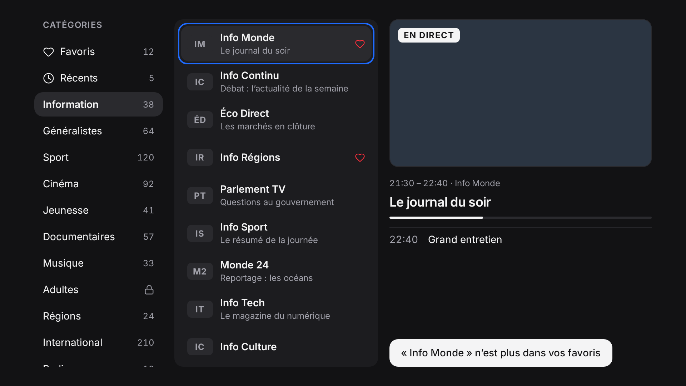

# Hey Stream

*[Français](README.fr.md)*

A clean, fast TV player for **Android TV, tablets and phones**: live channels
with preview, movies and series with resume, favorites, parental control.
Designed for the remote first, and tuned for a 2 GB, 32-bit Android TV box.
Free software (GPL-3.0), no account, no ads, no server: credentials stay on
the device.

> Hey Stream is only a player. It does not provide, sell or recommend any
> channel, stream or subscription, and is not affiliated with any provider.



## Why it's interesting to hack on

- **One Rust core, thin native UIs.** All logic (API client, SQLite catalog
  cache, search, parental control, resume) lives in `core/`, tested once and
  exposed to Kotlin and Swift through [UniFFI](https://mozilla.github.io/uniffi-rs/).
- **Low-end hardware as the target.** Reference device: Xiaomi Mi Box S 2nd gen
  (Cortex-A55, 2 GB RAM, 32-bit userspace). Catalogs of 100,000 entries stay in
  SQLite and are paged, never loaded whole.
- **Tolerant by design.** Provider APIs are messy; one unreadable entry is
  skipped, never fatal to a whole list.
- **No real server needed.** Every test runs against mocked responses
  (wiremock, MockWebServer), in CI and on your machine.

```
core/      Rust: API client, cache, search, parental control, playback logic
ffi/       UniFFI bindings (Kotlin, Swift)
android/   Kotlin + Jetpack Compose + Media3: phone, tablet, TV (one APK)
apple/     SwiftUI: iPhone, iPad, Apple TV            [help wanted]
site/      Public website (GitHub Pages)
docs/      Spec, decisions, design, hardware notes (French)
```

## Build and test

```sh
cargo test
cargo clippy --all-targets -- -D warnings
cd android && ./gradlew :app:testDebugUnitTest :app:assembleRelease
```

Android prerequisites (JDK 17+, NDK, Rust Android targets, `cargo-ndk`) are in
[`android/README.md`](android/README.md). Test APKs are attached to every CI run.

## Contributing

Pull requests are welcome. Start with [`CONTRIBUTING.md`](CONTRIBUTING.md) and
the issues labelled **good first issue**. Project docs and commit messages are
in French; issues and pull requests in English or French are both fine.

## License

GPL-3.0, see [`LICENSE`](LICENSE).
